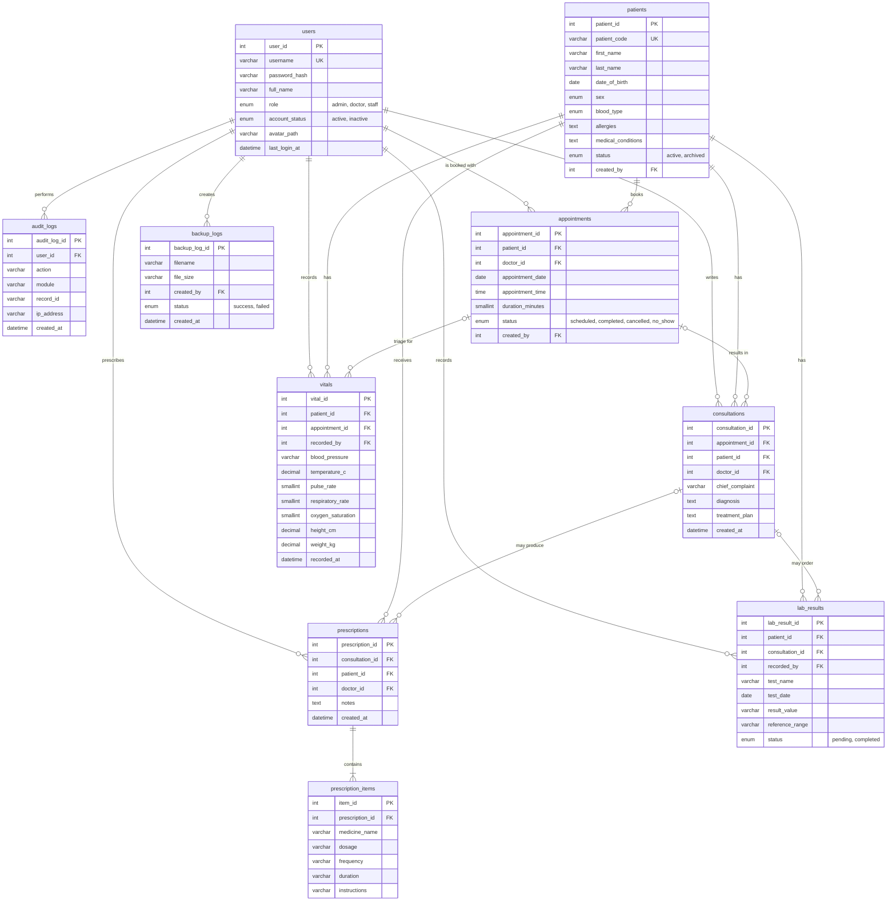

# EHR Management System
 
A web-based Electronic Health Record system for a small, private clinic. It keeps patient records, appointments, consultations, vitals, lab results, and prescriptions in one place, and limits what each person can see and do based on their role at the clinic.
 


 
> **Academic prototype.** Built as a course project for *Event-Driven Programming*. All patient data used for testing is fictional. This is not a certified healthcare system and should not be used with real patient information.
 
---
 
## Table of Contents
 
1. [Project Overview](#project-overview)
2. [Features](#features)
3. [Technologies Used](#technologies-used)
4. [Screenshots](#screenshots)
5. [Database Design](#database-design)
6. [Installation Guide](#installation-guide)
7. [Security Features](#security-features)
8. [Future Improvements](#future-improvements)
9. [Project Structure](#project-structure)
---
 
## Project Overview
 
### The problem
 
Small clinics often run on paper logbooks, spreadsheets, or a mix of both. That causes a few predictable problems:
 
- A patient's history is scattered, so a doctor may see them without their allergies or last visit in front of them.
- Double-booked appointments and no clear view of the day's schedule.
- No record of who changed what, which makes mistakes hard to trace.
- Everyone can see everything, or nobody can find anything.
### What this system does
 
It models the real flow of a clinic visit and splits the work between three roles:
 
1. **Staff** register the patient, book the appointment, and record vitals at triage.
2. **The doctor** sees the day's schedule, opens the consultation with the vitals already on screen, records the diagnosis and treatment, and prescribes if needed.
3. **The administrator** manages accounts, reviews the audit trail, and keeps database backups, without ever opening a patient's clinical record.

 
### Scope
 
The project is deliberately limited to the day-to-day work of a small clinic. It does **not** include pharmacy inventory, billing or insurance, telemedicine, or patient logins. Patients are records managed by clinic staff.
 
---
 
## Features
 
### All users
 
- Sign-in and sign-out through asynchronous requests, with SweetAlert2 feedback
- Automatic sign-out after 30 minutes of inactivity
- **My Account:** edit your name, upload a profile photo, change your password with a live strength meter
- Responsive layout with a collapsing mobile menu, so the Log Out button is always reachable on a phone
### Staff / Nurse
 
- Register, search, and edit patient records, with auto-generated patient IDs (`PT-2026-0001`)
- **Archive and restore** patients instead of deleting them; archived records stay viewable but read-only
- Schedule appointments with a choice of visit length, with:
  - **Double-booking prevention.** Overlapping visits for the same doctor are rejected (back-to-back is allowed)
  - **Clinic-hours enforcement.** A visit must finish by closing time
- Record vitals (blood pressure, temperature, pulse, respiration, oxygen saturation, height, weight) with range validation
- Record laboratory results
- Reports on appointment outcomes and new patient registrations
- Printable **patient summary / referral slip**
### Doctor
 
- Live dashboard of today's schedule and workload
- Read-only view of any active patient's profile, vitals, labs, and history
- **Start a consultation from an appointment.** The visit's vitals appear as reference. Saving creates the consultation *and* marks the appointment completed in a single database transaction
- Prescriptions with several medicines each (rows are added and removed dynamically)
- Mark no-shows
- Personal reports: consultations, patients seen, most common diagnoses
- Printable patient summary / referral slip
### Administrator
 
- **User management:** create accounts, edit them (a written reason is required and is recorded in the audit log), activate or deactivate
- **Audit log viewer** with search and filters
- System-wide totals and charts, with no patient-level data
- **Backup & Recovery:** create, download, restore, and delete database backups
### Who can do what (as exposed in the interface)
 
| Capability | Admin | Doctor | Staff |
|---|:---:|:---:|:---:|
| Manage user accounts, view audit logs | ✅ | | |
| Backup and restore the database | ✅ | | |
| Register / edit / archive patients | | | ✅ |
| View patient records | | ✅ | ✅ |
| Schedule and cancel appointments | | | ✅ |
| Record vitals and lab results | | | ✅ |
| Write consultations and diagnoses | | ✅ | |
| Create prescriptions | | ✅ | |
| Print patient summary | | ✅ | ✅ |
| Reports | system totals | own clinical stats | operational |
 
### Event-driven design
 
Because this was built for an Event-Driven Programming course, the front end is organized around events rather than page reloads:
 
- Event sources, listeners, and handlers throughout (`click`, `submit`, `input`, `change`, `beforeprint`)
- **Event delegation:** one listener on a table body handles every row and every row button, including rows that are re-rendered by a search
- **Asynchronous flow:** `fetch()` with `async/await` for login, search, saving, and loading, so the page stays responsive while the server works
- Debounced live search, and a modal system driven entirely by events
---
 
## Technologies Used
 
| Layer | Technology |
|---|---|
| Backend | PHP 8 (procedural, no framework), `mysqli` with prepared statements |
| Database | MySQL / MariaDB (InnoDB, foreign keys, transactions) |
| Frontend | HTML5, CSS3 (Grid and Flexbox), vanilla JavaScript (ES6+) |
| Async | Fetch API, `async/await`, JSON endpoints |
| UI libraries | [SweetAlert2](https://sweetalert2.github.io/) (dialogs and toasts), Google Fonts (Fraunces, Plus Jakarta Sans) |
| Local environment | XAMPP (Apache, MySQL, phpMyAdmin), Visual Studio Code |
 
There are no frameworks or build steps. The goal was to show the underlying PHP, MySQL, and JavaScript directly.
 
---
 
## Screenshots
 
> Add your screenshots to `docs/screenshots/` using the filenames below. Use fictional data only.
 
| | |
|---|---|
| **Login** <br>  | **Staff dashboard** <br>  |
| **Patients: active and archived** <br>  | **Patient profile** <br>  |
| **Scheduling with conflict detection** <br>  | **Doctor: start consultation** <br>  |
| **Prescription with multiple medicines** <br>  | **Reports with PDF export** <br>  |
| **Patient summary / referral slip** <br>  | **Admin: audit logs** <br>  |
| **Admin: backup & recovery** <br>  | **Mobile view** <br>  |
 
---
 
## Database Design
 
The schema has **10 tables**. Timestamps and a few secondary columns are omitted from the diagram for readability; the full definitions are in [`database/schema.sql`](database/schema.sql).
 

 
**Design notes**
 
- **Soft delete.** Patients are archived (`status = 'archived'`), never removed, so clinical history is preserved.
- **Consultations are final.** Once saved, a consultation is a permanent record and is not editable.
- **Several users, one table.** Doctors, staff, and admins all live in `users`; the `role` column drives access control. Columns such as `created_by` and `recorded_by` also reference `users` (those lines are left off the diagram to keep it readable).
- **Foreign-key behaviour is chosen deliberately.** Deleting a patient cascades to their visits, but a doctor account cannot be deleted while records reference it (`ON DELETE RESTRICT`).
- **One-to-many prescriptions.** A prescription holds several `prescription_items`.
---
 
## Installation Guide
 
### Requirements
 
- [XAMPP](https://www.apachefriends.org/) (or any Apache + PHP + MySQL/MariaDB stack) with **PHP 8.0 or newer**. Developed on PHP 8.2.
- A modern browser (Chrome, Edge, Firefox, Safari)
- Internet access in the browser (SweetAlert2 and Google Fonts load from a CDN)
### Steps
 
**1. Get the code**
 
```bash
git clone https://github.com/ja1rene/EHR.git C:\xampp\htdocs\EHRSystem
```
 
Or download the ZIP and extract it into `htdocs`. The folder can have any name, because the app works out its own URL path.
 
**2. Start the servers**
 
Open the XAMPP Control Panel and start **Apache** and **MySQL**.
 
**3. Create the database**
 
1. Open <http://localhost/phpmyadmin>
2. Click **Import**, choose `database/schema.sql`, and click **Import**
This creates the `ehr_system` database, all 10 tables, and three demo accounts.
 
**4. Check the database connection**
 
Open `config/db.php`. The defaults match a fresh XAMPP install, so you only need to edit it if your setup differs:
 
```php
$host     = "localhost";
$username = "root";
$password = "";
$database = "ehr_system";
```
 
**5. Set the clinic details** *(optional)*
 
Open `config/clinic_config.php` to set the clinic name shown on printed reports and the opening hours that limit appointment times (default 6:00 AM to 9:00 PM).
 
**6. Configure backups** *(only if you want to use Backup & Recovery)*
 
Open `config/backup_config.php` and confirm the two paths point to your MySQL tools. The Windows XAMPP defaults are:
 
```php
define('BACKUP_MYSQLDUMP_PATH', 'C:\\xampp\\mysql\\bin\\mysqldump.exe');
define('BACKUP_MYSQL_PATH',     'C:\\xampp\\mysql\\bin\\mysql.exe');
```
 
On Linux, XAMPP uses `/opt/lampp/bin/mysqldump` and `/opt/lampp/bin/mysql`. Backups are saved in an `ehr_backups` folder next to `htdocs`, outside the web-accessible directory, and that folder must be writable.
 
**7. Open the app**
 
Go to <http://localhost/EHRSystem/> (use your folder name) and sign in.
 
### Demo accounts
 
| Role | Username | Password |
|---|---|---|
| Administrator | `admin` | `Admin123!` |
| Doctor | `doctor` | `Doctor123!` |
| Staff / Nurse | `staff` | `Staff123!` |
 
> These exist for local testing only. Change or delete them before using the system for anything real.
 
### Troubleshooting
 
| Symptom | Likely cause |
|---|---|
| "Network error" or lists stay empty | The schema wasn't imported fully (a table is missing). Re-import `schema.sql` into an empty database and check the browser's Network tab. |
| Pages or links return 404 | The project isn't inside `htdocs`, or Apache isn't running. |
| Backup fails | The `mysqldump` path in `config/backup_config.php` doesn't match your install. |
| Profile photo won't upload | `assets/uploads/avatars/` isn't writable. |
 
---
 
## Security Features
 
Security was treated as a requirement from the start rather than added at the end. Every request passes the same checks:
 
> authenticated? → authorized for this role? → valid CSRF token? → input valid? → query parameterized? → output escaped? → action audited?
 
**Authentication and sessions**
 
- Passwords are hashed with `password_hash()` and checked with `password_verify()`. Plain text is never stored.
- Login errors are generic, so they never reveal whether the username or the password was wrong.
- The session ID is regenerated at login to prevent session fixation.
- Sessions expire after 30 minutes of inactivity, enforced on the server.
- Inactive accounts are rejected at login and on every later request.
- A password policy (minimum 8 characters with a letter, a number, and a symbol) is enforced on the server, with a live strength meter in the browser.
**Authorization**
 
- Role-based access control is checked on the server for every page and every API endpoint. Hiding a button is never the only protection.
- **IDOR prevention.** Before acting on a record, the server confirms it exists and that the current user may act on it. For example, a doctor can only change or consult on their own appointments.
- The administrator role has no access to clinical data, by design.
- An administrator cannot edit or deactivate their own account in user management, which avoids an accidental lockout.
**Injection and output**
 
- All database access uses prepared statements (`mysqli` with `bind_param`).
- Output is escaped in PHP (`htmlspecialchars`) and in JavaScript before it is placed in the page, to prevent XSS.
- Errors returned to the browser are generic. SQL errors and stack traces are never exposed.
**Request integrity**
 
- Every state-changing request requires a CSRF token. Tokens are rotated on each use, compared with `hash_equals()`, and refreshed in each JSON response so retries keep working.
- Uploaded profile photos are validated by their actual content (`getimagesize()`), not just the file extension, and limited to JPG, PNG, or WEBP under 2 MB.
**Data integrity**
 
- Saving a consultation and completing its appointment happen in **one database transaction**, so one cannot succeed without the other.
- The double-booking check runs inside a transaction with a row lock, so two staff members booking the same slot at the same moment cannot both succeed.
- Appointment status only moves forward (scheduled → completed, cancelled, or no-show). It can't be set back, which would bypass the conflict check.
- Records are archived rather than deleted.
**Accountability and recovery**
 
- An **audit log** records sign-ins (including failures), record changes, administrative actions, and backups, with the user, time, and IP address. Administrator edits to another user's account require a written reason.
- **Backup & Recovery** stores backup files outside the web root, serves downloads only through an authenticated endpoint, builds shell commands with `escapeshellarg()`, and restricts restore and delete to `.sql` files inside the backup folder.
---
 
## Future Improvements
 
**Security hardening**
 
- Login rate limiting and temporary account lockout after repeated failed attempts
- Session cookie flags (`HttpOnly`, `SameSite`, and `Secure` once served over HTTPS)
- Optional two-factor authentication for administrators
- Store text unmodified and escape only on output, which avoids double-encoding of characters like apostrophes
**Clinical features**
 
- Link prescriptions and lab results to a specific consultation in the interface (the database columns already exist)
- Active/resolved status for diagnoses and medications, and standardized diagnosis codes (ICD-10) instead of free text
- Per-doctor working hours, breaks, and clinic closed days (hours are currently global)
- Check that a *patient* isn't booked in two places at once
**Operations**
 
- Scheduled automatic backups
- Pagination for large lists (lists are currently capped at a fixed number of rows)
- Appointment reminders by SMS or email
**Engineering**
 
- Move shared CSS into a single stylesheet, which would also make a dark mode easy
- Automated tests for the API endpoints
- A Docker setup for one-command local installation
---
 
## Project Structure
 
```
EHRSystem/
├── index.php · login.php · logout.php     Entry points and session routing
├── account.php                            My Account (profile, photo, password)
├── patient_summary.php                    Printable patient summary / referral slip
├── about.php · 403.php
│
├── config/
│   ├── db.php                             Database connection
│   ├── clinic_config.php                  Clinic name and opening hours
│   └── backup_config.php                  mysqldump / mysql paths, backup folder
│
├── includes/
│   ├── auth.php                           Login/role checks, audit logging, base_url()
│   ├── security.php                       Sessions, CSRF, input cleaning, password policy
│   ├── dashboard_shell.php                Shared layout, navigation, print styles
│   └── patient_profile.php                Shared patient profile (staff and doctor)
│
├── api/                                   JSON endpoints called with fetch()
├── admin/    ├── doctor/    ├── staff/    Role-specific pages
│
├── assets/
│   ├── js/password-strength.js            Reusable strength meter
│   └── uploads/avatars/                   Profile photos
│
├── database/schema.sql                    Fresh-install schema + demo accounts
└── docs/                                  Flowchart and screenshots
```
 
---
 
*Built as a course project. All patient data in this repository is fictional.*
 
